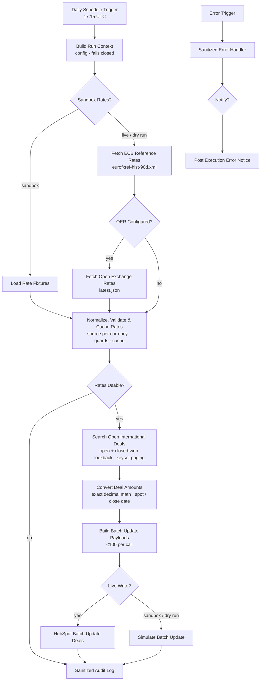

# n8n-multi-currency-exchange-rate-hubspot-sync

**A daily n8n pipeline that fetches exchange rates from the European Central Bank (and, optionally, Open Exchange Rates) and converts every open, and recently won, international HubSpot deal into one base reporting currency. It then writes the standardized amount, the rate used and the rate date back to the deal.**

I built this for revenue teams who sell in several currencies but report in one. HubSpot keeps each deal's amount in its own currency. That's correct for the customer, but it makes pipeline reports, board decks and comp plans awkward. This workflow gives every deal a consistent, auditable base-currency value:
- **The conversion is reproducible.** `fx_amount_base` is exactly `amount × fx_rate_used`, rounded to the base currency's minor units.
- **The source is recorded.** Each deal says which rate source and which date were used.
- **Won deals are converted once and then frozen.** They use the rate of their close date.

> **Safe by default.** `SANDBOX_MODE=true` and `DRY_RUN=true`. Out of the box, the workflow runs only on pinned, fictional rates and deals. Sandbox makes no outside calls. Dry run reads real rates and real deals but writes nothing.

Built by DH Robin, Revenue Infrastructure Architect · dhRobin Systems · MIT licensed.

---

## Table of Contents

1. [What it does](#1-what-it-does)
2. [Architecture](#2-architecture)
3. [Repository layout](#3-repository-layout)
4. [Prerequisites](#4-prerequisites)
5. [Data schema](#5-data-schema)
6. [Rate sources & normalization](#6-rate-sources--normalization)
7. [Conversion math & rounding](#7-conversion-math--rounding)
8. [Multi-currency handling edges](#8-multi-currency-handling-edges)
9. [Environment variables](#9-environment-variables)
10. [Node configuration guide](#10-node-configuration-guide)
11. [Deployment steps & testing stages](#11-deployment-steps--testing-stages)
12. [Sanitized audit logging & security](#12-sanitized-audit-logging--security)
13. [Troubleshooting](#13-troubleshooting)
14. [Known limitations](#14-known-limitations)
15. [Disclaimer & license](#15-disclaimer--license)

---

## 1. What it does

Every day at 17:15 UTC, after the ECB publishes its reference rates (around 16:00 CET), the workflow runs these steps:

1. **Fetch rates.** It downloads the ECB's free reference-rate file covering the last ~90 working days, plus Open Exchange Rates' latest rates if you configure an App ID.
2. **Normalize and check rates.**
   - It picks one source per currency and builds cross rates into your `BASE_CURRENCY`.
   - It holds any currency whose rate is stale, jumped too far overnight, or disagrees between the two sources.
   - It caches the last good rates.
3. **Find deals.** It searches HubSpot for **open deals** plus **deals won in the last 30 days**, paging past HubSpot's 10,000-result search limit.
4. **Convert.**
   - **Open deals:** today's spot rate.
   - **Won deals:** the ECB rate of their close date (or the last working day before it), after which they're frozen.
   - Deals that are locked, incomplete, held or unchanged are skipped, each with a recorded reason.
5. **Write.** It updates the `fx_` deal properties in batches of 100. Nothing is written in sandbox or dry run.
6. **Log.** It writes one sanitized audit record per run.

## 2. Architecture



| Required component | Nodes |
|---|---|
| Schedule trigger (daily execution) | `Daily Schedule Trigger` |
| HTTP request to ECB / Open Exchange Rates | `Fetch ECB Reference Rates`, `Fetch Open Exchange Rates` (HTTP Request nodes) |
| Rate normalization & caching | `Normalize, Validate & Cache Rates` |
| HubSpot deals search for open international deals | `Search Open International Deals` |
| Currency conversion math (spot or historical) | `Convert Deal Amounts` |
| HubSpot deals batch update | `Build Batch Update Payloads`, `HubSpot Batch Update Deals` (HTTP Request node) |
| Sanitized audit logging | `Sanitized Audit Log`, `Sanitized Error Handler` |

**Why I write custom properties instead of HubSpot's own conversion.** HubSpot's native multi-currency feature calculates *Amount in company currency* from exchange rates you maintain inside HubSpot. It converts into your *company* currency, and HubSpot doesn't update the rate automatically on closed deals. This workflow leaves HubSpot's native fields alone and writes its own `fx_` properties. You get:
- a reporting currency independent of the company currency;
- a documented rate source and date on every deal;
- a frozen value for won deals.

You can run both side by side.

## 3. Repository layout

```
n8n-multi-currency-exchange-rate-hubspot-sync/
├── README.md        ← this file
├── workflow.json    ← import into n8n (inactive, sandbox defaults, pinned fixtures)
├── DISCLAIMER.md
└── LICENSE          ← MIT
```

No database is needed. The rate cache and the audit ring buffer live in n8n's workflow static data, and the results live on the deals themselves.

## 4. Prerequisites

| Item | Notes |
|---|---|
| n8n | 1.x, with `N8N_BLOCK_ENV_ACCESS_IN_NODE=false` and `NODE_FUNCTION_ALLOW_BUILTIN=crypto` (used only for run IDs) |
| Code-node HTTP helper | The deal search pages through HubSpot from a Code node with `this.helpers.httpRequest`. If your n8n build doesn't expose it, the search reports `http_helper_unavailable` and nothing is converted. Check it in Stage 2. |
| HubSpot | A private app (`YOUR_HUBSPOT_TOKEN`) with `crm.objects.deals.read` and `crm.objects.deals.write`, plus `crm.schemas.deals.write` once, to create the properties |
| ECB | Nothing: the reference rates are free and need no key. Outbound HTTPS to `www.ecb.europa.eu`. |
| Open Exchange Rates | Optional App ID (`YOUR_OER_APP_ID`). The free plan is USD-based and covers currencies the ECB doesn't publish. |

## 5. Data schema

### 5.1 HubSpot deal properties (written)

Prefix: `HUBSPOT_FX_PROPERTY_PREFIX` (default `fx_`).

| Property | Type | Example | Meaning |
|---|---|---|---|
| `fx_amount_base` | number | `34982.05` | Deal amount in the base currency, rounded to its minor units |
| `fx_base_currency` | single-line text | `USD` | The base currency used |
| `fx_rate_used` | number | `0.006478157` | 1 unit of the deal currency = x base units (10 decimal places) |
| `fx_rate_date` | date | `2026-11-16` | Date of the rate (the ECB publication date, or the OER snapshot date) |
| `fx_rate_source` | dropdown | `ecb` · `oer` · `identity` | Where the rate came from (`identity` = deal already in the base currency) |
| `fx_rate_basis` | dropdown | `spot` · `close_date` | Daily spot rate, or the rate of the close date (won deals) |
| `fx_source_amount` | number | `5400000` | The `amount` that was converted |
| `fx_source_currency` | single-line text | `JPY` | The `deal_currency_code` that was converted |
| `fx_synced_at` | date-time | `2026-11-16T17:15:04Z` | When the values were written |
| `fx_lock` | single checkbox (read) | `true` | Set it by hand to stop the workflow touching a deal |

**Read:** `amount`, `deal_currency_code`, `hs_is_closed`, `hs_is_closed_won`, `closedate`, `pipeline`, `hs_lastmodifieddate` and the `fx_` properties above.

**Create the properties once:**

```bash
curl -s -X POST https://api.hubapi.com/crm/v3/properties/deals/groups \
  -H "Authorization: Bearer YOUR_HUBSPOT_TOKEN" -H "Content-Type: application/json" \
  -d '{"name":"fx_reporting","label":"FX reporting"}'

curl -s -X POST https://api.hubapi.com/crm/v3/properties/deals/batch/create \
  -H "Authorization: Bearer YOUR_HUBSPOT_TOKEN" -H "Content-Type: application/json" -d '{"inputs":[
  {"name":"fx_amount_base","label":"Amount (base currency)","groupName":"fx_reporting","type":"number","fieldType":"number"},
  {"name":"fx_base_currency","label":"Base currency","groupName":"fx_reporting","type":"string","fieldType":"text"},
  {"name":"fx_rate_used","label":"FX rate used","groupName":"fx_reporting","type":"number","fieldType":"number"},
  {"name":"fx_rate_date","label":"FX rate date","groupName":"fx_reporting","type":"date","fieldType":"date"},
  {"name":"fx_rate_source","label":"FX rate source","groupName":"fx_reporting","type":"enumeration","fieldType":"select","options":[
   {"label":"European Central Bank","value":"ecb"},{"label":"Open Exchange Rates","value":"oer"},{"label":"Same currency","value":"identity"}]},
  {"name":"fx_rate_basis","label":"FX rate basis","groupName":"fx_reporting","type":"enumeration","fieldType":"select","options":[
   {"label":"Daily spot","value":"spot"},{"label":"Close date","value":"close_date"}]},
  {"name":"fx_source_amount","label":"FX source amount","groupName":"fx_reporting","type":"number","fieldType":"number"},
  {"name":"fx_source_currency","label":"FX source currency","groupName":"fx_reporting","type":"string","fieldType":"text"},
  {"name":"fx_synced_at","label":"FX synced at","groupName":"fx_reporting","type":"datetime","fieldType":"date"},
  {"name":"fx_lock","label":"FX lock (manual)","groupName":"fx_reporting","type":"bool","fieldType":"booleancheckbox",
   "options":[{"label":"Yes","value":"true"},{"label":"No","value":"false"}]}]}'
```

In reports, format `fx_amount_base` as a plain number labeled with your base currency. A HubSpot currency-formatted custom property displays the *company* currency symbol, which would be misleading if your base currency differs.

### 5.2 Rate table (in memory, per run)

```json
{ "GBP": { "rate": "1.2669103109", "source": "ecb", "date": "2026-11-16", "dayChangePct": 0.019, "crossSourceDiffPct": 0.001 },
  "ARS": { "rate": "0.0009876543", "source": "oer", "date": "2026-11-16" } }
```

`held` lists the currencies that are blocked for this run, with the reason (for example `"TRY": "rate_change_guard:11.549%"`).

### 5.3 Rate cache (workflow static data `fxRateCache`)

```json
{ "ecbDays": { "2026-11-13": { "EUR": "1", "USD": "1.0551", "GBP": "0.83390" }, "2026-11-16": { } },
  "oer": { "anchor": "USD", "date": "2026-11-16", "rates": { "EUR": "0.945805", "ARS": "1012.5" } },
  "oerPrev": { "anchor": "USD", "date": "2026-11-13", "rates": { } } }
```

**How the cache is used:**
- **Contents:** the last ~130 ECB days, kept as raw anchor rates exactly as published, plus the current and previous OER snapshots.
- **Fallback:** used when a fetch fails, but only while the cached rates are younger than `MAX_RATE_AGE_DAYS`.
- **Day-over-day check:** the previous OER snapshot feeds the jump guard for OER currencies.
- **Not used in sandbox.**

### 5.4 Audit record

Shape of each record, shown with sandbox values (see section 12):

```json
{ "record": "fx_sync_run", "runId": "fx_…", "mode": "sandbox", "outcome": "completed",
  "config": { "base": "USD", "rateSource": "ecb_then_oer", "rounding": "half_up", "baseDecimals": 2, "closedPolicy": "close_date" },
  "rates": { "ecbLatest": "2026-11-16", "oerDate": "2026-11-16", "currencies": 12, "bySource": { "ecb": 9, "oer": 3 }, "held": { "TRY": "rate_change_guard:11.549%" }, "warnings": [] },
  "search": { "pages": 1, "deals": 20, "truncated": false, "error": null },
  "conversion": { "deals": 20, "updates": 11, "byReason": { "update": 11, "unchanged": 1, "locked": 1 } },
  "writes": { "simulated": true, "batches": 1, "wouldUpdate": 11 },
  "deals": [{ "id": "4100003", "currency": "JPY", "basis": "spot", "action": "update", "rate": "0.006478157", "rateDate": "2026-11-16", "source": "ecb", "from": null, "to": "34982.05" }] }
```

## 6. Rate sources & normalization

| Source | Request | Anchor | Notes |
|---|---|---|---|
| **ECB** | `GET https://www.ecb.europa.eu/stats/eurofxref/eurofxref-hist-90d.xml` | EUR | About 30 major currencies, working days only, usually published around 16:00 CET. The newest day is the spot rate; the rest provides close-date history. The ECB publishes these reference rates for information purposes, not for transactions (see section 14). |
| **Open Exchange Rates** | `GET https://openexchangerates.org/api/latest.json`, App ID sent as `Authorization: Token …` | USD (free plan) | 170+ currencies. The free plan can't change `base`, so I always compute cross rates and never send `base`. One request per day. |

**One source per currency.** `RATE_SOURCE` picks the order:

| Value | Meaning |
|---|---|
| `ecb_then_oer` (default) | ECB where it publishes the currency, OER for the rest |
| `oer_then_ecb` | The reverse |
| `ecb` | ECB only |
| `oer` | OER only |

Both sides of a cross rate always come from **the same source and the same date**. I never mix an ECB rate with an OER rate in one calculation.

**Cross rates.** A rate published as "1 anchor = x units" gives:

```
rate(deal currency → base) = anchor_per_base / anchor_per_deal_currency
e.g. ECB:  JPY→USD = 1.0573 / 163.21 = 0.0064781570
     OER:  KWD→USD = 1 / 0.30712     = 3.2560562647
```

**Guards.** Each guard **holds** the currency: its deals keep their current values and appear in the audit as `held:…`.

| Guard | Default | Trigger |
|---|---|---|
| Stale | `MAX_RATE_AGE_DAYS=4` | The newest rate is older than this (4 days covers a long weekend plus a TARGET holiday). If *no* fresh rate remains, the run aborts before touching HubSpot. |
| Day-over-day jump | `MAX_DAILY_RATE_CHANGE_PCT=10` | The cross rate moved more than this since the previous ECB day or previous OER snapshot |
| Cross-source disagreement | `CROSS_SOURCE_TOLERANCE_PCT=2` | ECB and OER both publish the currency and differ by more than this |

Set a value to `0` to turn that guard off.

## 7. Conversion math & rounding

- **Exact decimals.** All arithmetic uses integer (BigInt) math on decimal strings, with no floating point:
  - the rate is computed at `RATE_DECIMALS` (10) and stored with that precision;
  - `fx_amount_base = round(amount × fx_rate_used, base minor units)`, so anyone can reproduce it from the two stored values.
- **Rounding.** `ROUNDING_MODE=half_up` (default; ties away from zero) or `half_even` (banker's rounding). For example, `10.125` becomes `10.13` with `half_up` and `10.12` with `half_even`.
- **Minor units.** ISO 4217 minor units of the base currency are used automatically:
  - 0 decimals: JPY, KRW, VND, CLP, ISK and others;
  - 3 decimals: BHD, KWD, OMR, JOD, TND, LYD, IQD;
  - 2 decimals: everything else.
  
  Override with `BASE_AMOUNT_DECIMALS`.
- **Basis.** **Open deals** use spot. **Closed-won deals** (within `CLOSED_WON_LOOKBACK_DAYS`) use the ECB rate of the close date, or the last working day before it if the deal closed on a weekend or holiday. Once written with `fx_rate_basis=close_date`, they're **frozen**: re-converted only if their amount, currency or base currency changes.

## 8. Multi-currency handling edges

| Situation | Behavior |
|---|---|
| Deal already in the base currency | `identity` rate 1, written so every deal has `fx_amount_base` (`INCLUDE_BASE_CURRENCY_DEALS=false` to skip) |
| Empty `deal_currency_code` | Treated as `HUBSPOT_COMPANY_CURRENCY` (default: the base currency), as HubSpot does |
| Invalid currency code (`XYZ1`) | Skipped, `invalid_currency` |
| Currency no source publishes | Skipped, `no_rate_for_currency` (add OER, or change `RATE_SOURCE`) |
| Empty amount | Skipped, `missing_amount` |
| `1,200` or other formatted text in `amount` | Skipped, `unparseable_amount` (never guessed) |
| Negative amount | Skipped, `negative_amount` (`ALLOW_NEGATIVE_AMOUNTS=true` for credit deals) |
| Amount edited since the last sync | Re-converted (`fx_source_amount` no longer matches) |
| Same result as last time | **No write** (`unchanged`). This keeps property history clean; `fx_rate_date` then shows the last date the value actually changed. |
| `fx_lock = true` | Skipped, `locked` (manual overrides stay) |
| Closed lost | Not searched; skipped if seen |
| Won deal, close date on a weekend | ECB rate of the previous working day |
| Won deal closed before the rate history | Skipped, `close_date_before_rate_history` (the ECB file covers about 90 working days) |
| Won deal already frozen | Skipped, `frozen_at_close` |
| `CLOSED_DEAL_POLICY=skip` | Won deals are not searched |
| Currency held by a guard | Skipped, `held:<reason>` |
| More than 10,000 deals | Keyset paging (`hs_object_id > last id`) beyond HubSpot's search window, up to `MAX_DEALS_PER_RUN` (20,000) |
| More than `MAX_UPDATES_PER_RUN` (5,000) changes | The rest are skipped as `max_updates_per_run` and picked up the next day |
| Partial batch failure (HTTP 207) | Counted per deal; outcome `completed_with_errors`; failed deals are retried the next day automatically (they're still "changed") |
| Base currency changed | Every deal is re-converted on the next run (`fx_base_currency` differs) |

## 9. Environment variables

Copy this block into your n8n environment and replace every placeholder.

```bash
# ── Safety switches ──
SANDBOX_MODE=true
DRY_RUN=true

# ── Currencies ──
BASE_CURRENCY=YOUR_BASE_CURRENCY          # e.g. USD, EUR, GBP, JPY
HUBSPOT_COMPANY_CURRENCY=                 # used for deals with no currency; defaults to BASE_CURRENCY
RATE_SOURCE=ecb_then_oer                  # ecb | oer | ecb_then_oer | oer_then_ecb
RATE_DECIMALS=10
ROUNDING_MODE=half_up                     # half_up | half_even
BASE_AMOUNT_DECIMALS=                     # empty = ISO 4217 minor units of BASE_CURRENCY

# ── Rate sources ──
ECB_RATES_URL=https://www.ecb.europa.eu/stats/eurofxref/eurofxref-hist-90d.xml
OER_APP_ID=YOUR_OER_APP_ID                # optional
OER_API_BASE_URL=https://openexchangerates.org/api

# ── Rate guards ──
MAX_RATE_AGE_DAYS=4
MAX_DAILY_RATE_CHANGE_PCT=10
CROSS_SOURCE_TOLERANCE_PCT=2

# ── HubSpot ──
HUBSPOT_ACCESS_TOKEN=YOUR_HUBSPOT_TOKEN
HUBSPOT_API_BASE_URL=https://api.hubapi.com
HUBSPOT_FX_PROPERTY_PREFIX=fx_
HUBSPOT_PIPELINE_IDS=                     # optional, comma-separated pipeline IDs
CLOSED_WON_LOOKBACK_DAYS=30
CLOSED_DEAL_POLICY=close_date             # close_date | skip
INCLUDE_BASE_CURRENCY_DEALS=true
ALLOW_NEGATIVE_AMOUNTS=false
MAX_DEALS_PER_RUN=20000
MAX_UPDATES_PER_RUN=5000

# ── Error notices & audit ──
SLACK_WEBHOOK_URL=YOUR_SLACK_WEBHOOK_URL
SLACK_NOTIFY_ON_MONITOR_ERROR=true
AUDIT_LOG_TO_STDOUT=true
AUDIT_RING_BUFFER_SIZE=60

# ── n8n platform ──
N8N_BLOCK_ENV_ACCESS_IN_NODE=false
NODE_FUNCTION_ALLOW_BUILTIN=crypto
```

**Formats:**
- Flags accept only `true/1/yes/on` or `false/0/no/off`; anything else keeps the safe default.
- Values that still start with `YOUR_` count as not set.
- Outside sandbox, an unset `BASE_CURRENCY` aborts the run.
- Keep comments on their own lines if your env loader doesn't strip trailing comments.

## 10. Node configuration guide

| Node | Type | Key settings |
|---|---|---|
| Daily Schedule Trigger | Schedule Trigger v1.2 | cron `15 17 * * *` (UTC, after ECB publication). Move it to run after OER's snapshot of your choice if OER is your main source. |
| Build Run Context | Code v2 | reads and validates every variable once |
| Sandbox Rates? / OER Configured? / Rates Usable? / Live Write? | IF v2.2 | routing only |
| Fetch ECB Reference Rates | HTTP Request v4.2 | GET `ECB_RATES_URL` · response **text** · full response · never error · retry 3× |
| Fetch Open Exchange Rates | HTTP Request v4.2 | GET `{OER_API_BASE_URL}/latest.json` · header `Authorization: Token {{$env.OER_APP_ID}}` · full response · retry 3× |
| Normalize, Validate & Cache Rates | Code v2 | section 6 |
| Search Open International Deals | Code v2 | `POST /crm/v3/objects/deals/search` · 200 per page · 4 requests/second · 429/5xx back-off |
| Convert Deal Amounts | Code v2 | sections 7–8 |
| Build Batch Update Payloads | Code v2 | ≤100 deals per item |
| HubSpot Batch Update Deals | HTTP Request v4.2 | `POST /crm/v3/objects/deals/batch/update` · `Authorization: Bearer {{$env.HUBSPOT_ACCESS_TOKEN}}` · batching 1 item / 400 ms · retry 3× · continue on error |
| Simulate Batch Update / Sanitized Audit Log | Code v2 | section 12 |
| Error Trigger → Sanitized Error Handler | Error Trigger v1 + Code v2 | redacted summary, optional Slack notice |

**Prefer an n8n credential for the token?** Switch the batch-update node's authentication to **Predefined credential → HubSpot App Token**. The search Code node still reads `HUBSPOT_ACCESS_TOKEN`, so keep both pointing at the same private app.

## 11. Deployment steps & testing stages

### Deployment steps

1. In a **staging HubSpot portal** (or test account), create the `fx_` properties (section 5.1).
2. In n8n, go to **Workflows → Import from File** and select `workflow.json`. It imports **inactive**.
3. Set the environment variables (section 9) and restart n8n.
4. Set **Settings → Error Workflow** to this workflow.
5. Run the stages below, then activate the workflow.

### Stage 1 · Sandbox (pinned fixtures, no network)

`SANDBOX_MODE=true`. Execute **Daily Schedule Trigger**. The pinned data holds:
- 7 fictional ECB days (2026-11-06 → 2026-11-16);
- a fictional OER snapshot (plus the previous one);
- 22 fictional deals (IDs `4100001`–`4100022`), of which the search returns 20.

Base currency: USD.

| Deal | Input | Result |
|---|---|---|
| 4100001 | 48,500 EUR, open | **update** 51,279.05 USD · ECB 1.0573 |
| 4100002 | 12,999.99 GBP | **update** 16,469.82 · 1.2669103109 |
| 4100003 | 5,400,000 JPY | **update** 34,982.05 · 0.006478157 |
| 4100004 / 4100005 | 20,000 USD / 7,500 with no currency | **update** · identity rate 1 |
| 4100006 | 31,000 CHF, stored with an older rate | **update** 34,936.47 → 34,935.30 |
| 4100007 | 64,000 EUR, amount edited since the last sync | **update** 60,000.00 → 67,667.20 |
| 4100008 | 2,500,000 ARS (not published by the ECB) | **update** 2,469.14 · **OER** 0.0009876543 |
| 4100012 | 18,250 EUR, won on Sunday 2026-11-08 | **update** 19,147.90 · ECB rate of **Friday 2026-11-06**, basis `close_date` |
| 4100016 | 1,250.125 KWD (3-decimal currency) | **update** 4,070.48 · OER 3.2560562647 |
| 4100017 | 125,000,000.50 HUF | **update** 327,013.49 |
| 4100022 | 10,000 CHF, same result as last time | skip `unchanged` |
| 4100009 | currency `XYZ1` | skip `invalid_currency` |
| 4100010 | empty amount | skip `missing_amount` |
| 4100011 | `fx_lock = true` | skip `locked` |
| 4100013 | GBP, already frozen at its close date | skip `frozen_at_close` |
| 4100014 | −500 GBP | skip `negative_amount` |
| 4100015 | 410,000 TRY, rate jumped 11.5% overnight | skip `held:rate_change_guard` |
| 4100018 | SEK, won 2026-10-28 (before the fixture history) | skip `close_date_before_rate_history` |
| 4100021 | amount `1,200` | skip `unparseable_amount` |
| 4100019 / 4100020 | closed lost / won before the lookback | not returned by the search |

The run ends with 11 updates in 1 simulated batch.

All rates, deals and IDs are fictional. Beyond the sandbox, the workflow was tested in live mode against mocked HTTP:
- ECB outage with cache fallback, and stale rates aborting the run before any HubSpot call;
- EUR and JPY as base currencies, and both rounding modes on an exact half;
- a cross-source mismatch, and ECB-only mode;
- 10,250 deals read past the 10,000 search limit, with a 429 retry;
- the update cap, 207 partial failures, dry run, and the pipeline filter.

### Stage 2 · Shadow (real rates, staging portal, no writes)

`SANDBOX_MODE=false`, `DRY_RUN=true`, `BASE_CURRENCY` set. Execute manually and check the audit:
- `rates.ecbLatest` is the latest ECB working day;
- `search.error` is `null` (not `http_helper_unavailable`);
- the `deals[]` conversions match a spreadsheet check for a handful of deals.

### Stage 3 · Live on staging

`DRY_RUN=false`. Confirm:
- `fx_` properties appear on the staging deals;
- a second run on the same day writes nothing (`unchanged`);
- editing a deal amount triggers a re-conversion the next run;
- `fx_lock` is respected.

### Stage 4 · Production

Switch to the production token. Build reports on `fx_amount_base` and filter or group by `fx_rate_basis` and `fx_rate_source`. Review the audit after the first week.

## 12. Sanitized audit logging & security

- **One audit record per run** (section 5.4).
  - **Contents:** rate summary, held currencies, search statistics, and per-deal outcome (deal ID, currency, basis, rate, rate date, previous → new base amount, skip reason).
  - **No** deal names, companies, contacts, owners or tokens.
  - **Where:** written to stdout (`[fx-sync:audit]`) and to the `fxSyncAudit` ring buffer in workflow static data (not in sandbox; unchanged and frozen deals are left out of the buffer to keep it small).
- **No secrets in the workflow JSON.**
  - The HubSpot token and the OER App ID come from `$env`.
  - The OER App ID travels in the `Authorization` header, so it never appears in a URL, an execution log or an error message. The redactor also masks `app_id=` query values, `Bearer` and `Token` headers, HubSpot `pat-` tokens and Slack webhook URLs.
- **Fails closed.** Without a valid base currency, or without at least one fresh rate, the run stops before reading or writing deals.
- **Human review.** These values feed financial reports. Treat each run's changes as a draft until someone has checked them:
  - keep `DRY_RUN=true` until a person has compared the audit against your finance team's rates;
  - lock any deal whose value must not move (`fx_lock`).

## 13. Troubleshooting

| Symptom | Likely cause | Fix |
|---|---|---|
| `aborted:base_currency_not_configured` | `BASE_CURRENCY` unset or still `YOUR_BASE_CURRENCY` | Set a 3-letter ISO code |
| `aborted:no_fresh_rates` | ECB unreachable and no fresh cache; OER not configured | Allow egress to `www.ecb.europa.eu`; add an OER App ID as a second source |
| `warnings: ecb_from_cache` | ECB fetch failed today | Nothing to do while the cache is younger than `MAX_RATE_AGE_DAYS` |
| Many `held:rate_change_guard` | Real market move, or a bad publication | Check the rate; raise `MAX_DAILY_RATE_CHANGE_PCT` for that run if it's genuine |
| `held:cross_source_mismatch` | ECB and OER differ (snapshot times differ) | Raise `CROSS_SOURCE_TOLERANCE_PCT`, or set `RATE_SOURCE=ecb` |
| `search.error: http_helper_unavailable` | Code-node HTTP helper not exposed in your n8n build | Upgrade n8n, or check your version's task-runner settings |
| `search_http_403:MISSING_SCOPES` | Private app lacks deal scopes | Add `crm.objects.deals.read` and `crm.objects.deals.write` |
| Batch update 400 `PROPERTY_DOESNT_EXIST` | Properties not created, or a different prefix | Run the curl in section 5.1; match `HUBSPOT_FX_PROPERTY_PREFIX` |
| OER 403 about changing `base` | Something added `base=` to the request | Leave the URL as shipped; the workflow computes crosses itself |
| `fx_rate_date` looks old | The value hasn't changed since then (no write when unchanged) | Expected; `fx_synced_at` shows the last write |

## 14. Known limitations

- **The ECB rates are reference rates.** They're published once a day for information purposes, and the ECB discourages using them for transactions. They suit reporting, not invoicing.
- **Close-date history is ECB-only and covers about 90 working days.** Older won deals need a one-off backfill, for example from OER's historical endpoint on a paid plan or from your finance system.
- **One base currency per run.** To report in two currencies, duplicate the workflow with a different prefix.
- **HubSpot's native fields are untouched.** *Amount in company currency* and HubSpot's exchange rates are not updated.
- **Line items, quotes and products are not converted.** Only deals are.

---

## 15. Disclaimer & license

### ⚠️ Disclaimer & Liability Limitation

Use at your own risk. The code, workflows, and scripts in this repository (n8n-multi-currency-exchange-rate-hubspot-sync) are provided for educational and architectural demonstration purposes.

* **No Liability:** The author and dhRobin Systems accept no responsibility or liability for any direct, indirect, incidental, or consequential damages that result from using, misusing, or deploying these scripts.
* **No Warranty:** All software, n8n JSON blueprints, JavaScript modules and prompts are provided "AS IS", without warranty of any kind, express or implied. This includes, but is not limited to, warranties of merchantability, fitness for a particular purpose, and non-infringement.
* **Production Testing Required:** Always test thoroughly in an isolated staging environment, such as a staging HubSpot portal or test CRM tenant, with `SANDBOX_MODE=true` and `DRY_RUN=true` enabled, before you connect live currency APIs or production CRMs. Treat every automatic financial property update or currency recalculation as a draft that a person must verify before permanently altering production reporting values.
* **Third-Party APIs & Financial Compliance:** You alone are responsible for complying with the terms of service, rate limits, data accuracy, and financial reporting standards of the European Central Bank, Open Exchange Rates, HubSpot, and any connected services. That includes confirming the accuracy of exchange rate conversions, rounding rules, and tax or accounting compliance for multi-currency deal records.

The full disclaimer is also available in [DISCLAIMER.md](https://github.com/dhrobinsystems/n8n-multi-currency-exchange-rate-hubspot-sync/blob/main/DISCLAIMER.md).

### License

Released under the MIT License. Copyright (c) 2026 DH Robin (dhRobin Systems). See [LICENSE](https://github.com/dhrobinsystems/n8n-multi-currency-exchange-rate-hubspot-sync/blob/main/LICENSE).

---

Full text: DISCLAIMER.md · Licensed under the MIT License. License: MIT © 2026 DH Robin (dhRobin Systems) · Provided as-is, see the disclaimer.
